# Perks Portal

**An employee experiences portal an HR person designed for the company, not for the welfare vendor.**

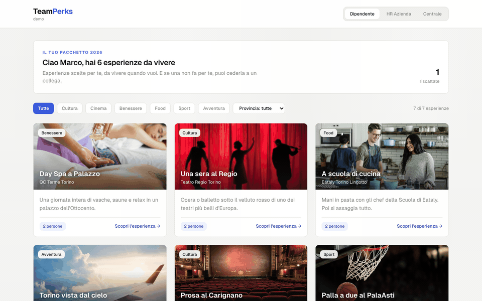

Built for a client, so the code isn't public. This repo is the case study: what it does, why it's built this way, and what it looks like. Happy to demo it live.

## The problem

Most companies that offer benefits buy a welfare platform: a credit wallet, a catalog of thousands of items, a fee on top. Then they find out nobody uses it. Employees open it once, scroll a marketplace that feels like a discount site, and forget the credits until December.

The issue isn't the budget, it's the shape of the product. A wallet of credits is a chore. Seven concrete things to do with your weekend are a gift.

## What it does

Three views, one product.

**Employee.** A short catalog of real local experiences (a night at the theatre, a spa day, a cooking class), picked by the company, each with everything you need to actually go: what's included, how to book, where, until when. You redeem it, you get a code. Don't fancy it? Give it to a colleague.

**HR.** Switch experiences on and off for the whole company and see the cost per head and the yearly budget move as you do. Upload the staff list as a CSV. See who uses what, and what your people like as a category, which is useful well beyond the portal: gifts, events, team days.

**Platform console.** Runs the catalog across every client company: code stock per supplier, a pipeline for new partnerships proposed by HR teams (validation, negotiation, sign-off), and which experiences to keep or drop based on real redemption.

## Design choices

- **A fixed package, not a wallet.** Each employee gets a set of experiences, on or off, instead of a pile of credits to spend. Less choice, much more use: the decision is already made, you just pick a date.
- **Few experiences, written like a friend would.** Every card answers "why would I go" before "how much is it". Seven good ones beat seven hundred mediocre ones.
- **Giving is a feature.** An unused benefit is wasted budget. Letting people pass it to a colleague keeps the value inside the company and tells HR something about who likes what.
- **HR proposes, the platform negotiates.** HR teams know what their people ask for. They suggest a supplier, the platform handles the deal, and once it's signed the experience is available to every client company.
- **White label from day one.** Name, logo and palette live in one config. The same product ships under each client's brand.

## Screenshots

### Employee

| | |
|---|---|
| 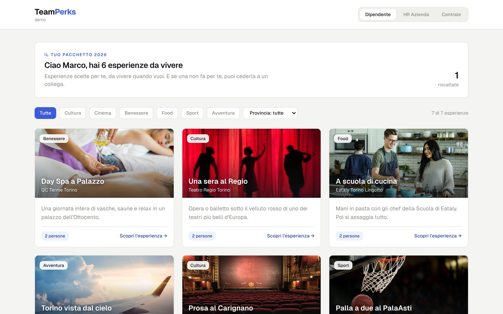 **Catalog.** What's in my package this year. | 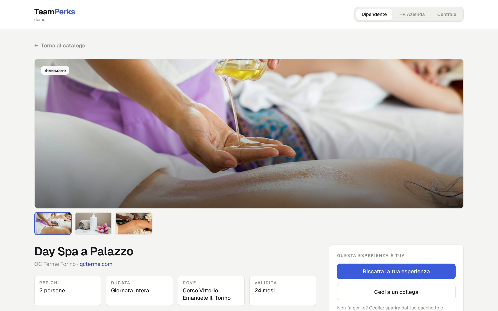 **Experience page.** Everything needed to actually go. |
| 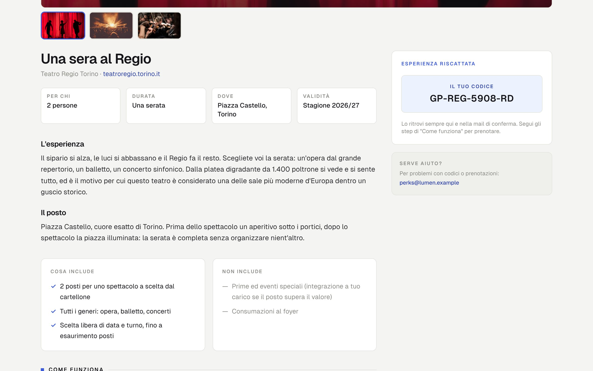 **Redeemed.** The code, plus the steps to book. | 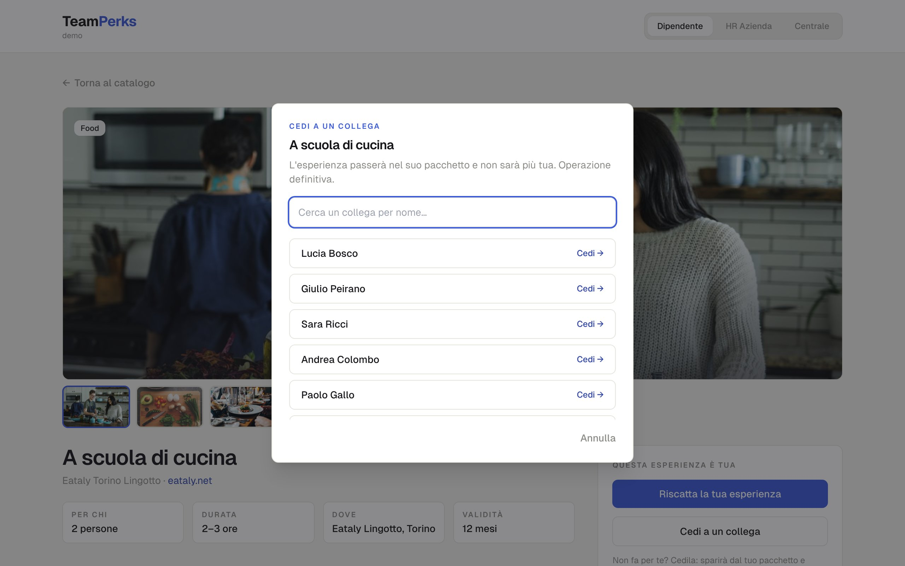 **Not for you?** Give it to a colleague. |

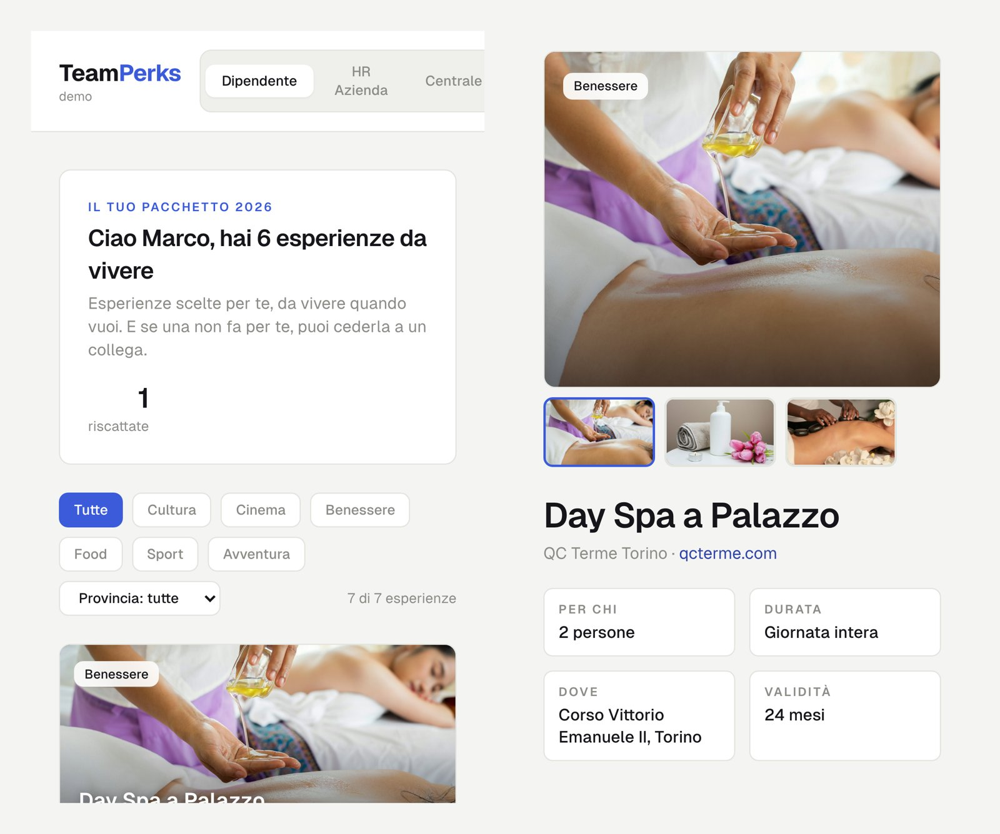
**On the phone,** where people actually open it.

### HR

| | |
|---|---|
| 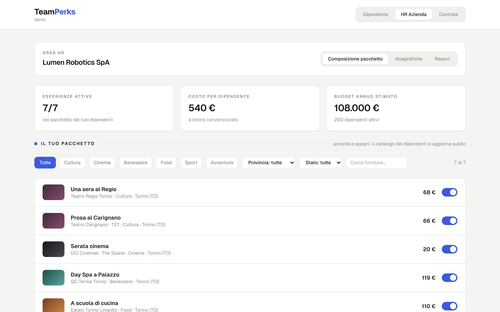 **Package.** Switch experiences on and off, budget updates live. | 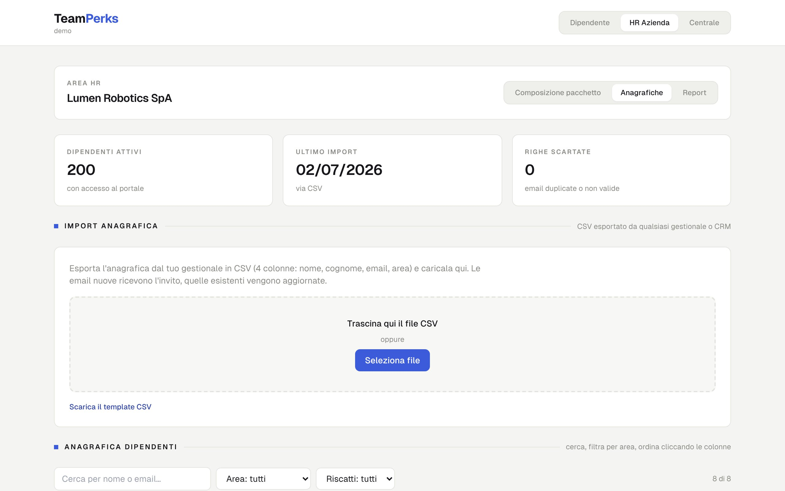 **Staff.** Import from any HR system as a CSV. |
| 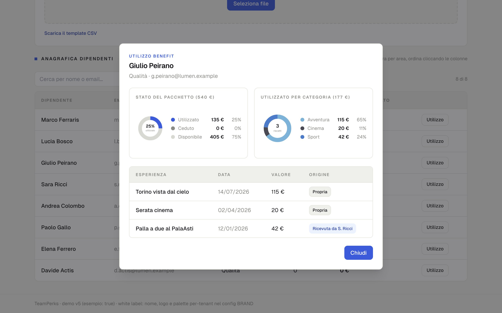 **One employee.** Package status and what they used, by category. | 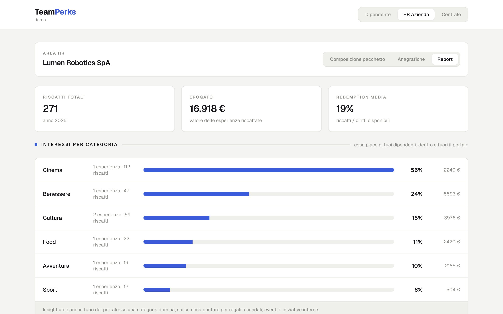 **Report.** Redemption by category and by experience. |

### Platform console

| | |
|---|---|
| 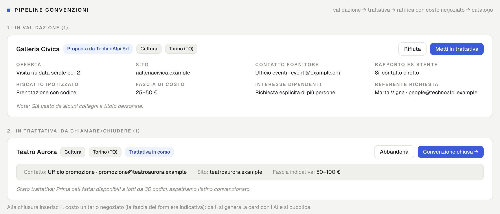 **Partnerships.** From an HR proposal to a signed deal. | 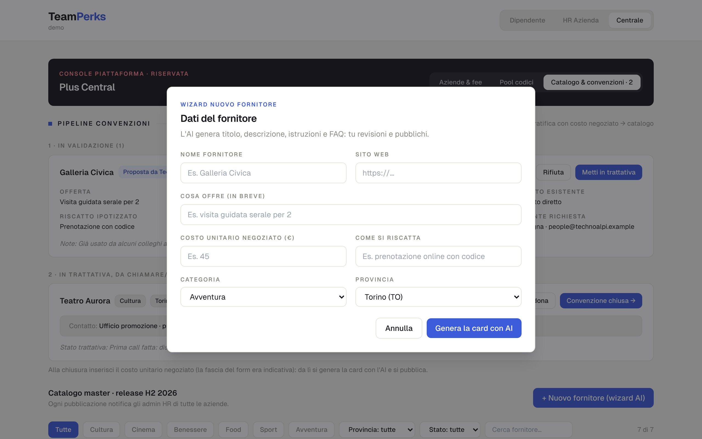 **New supplier.** Fill in the basics, AI writes the experience card, a human reviews and publishes. |

## Built with

React, Tailwind and Claude. Single-page demo, mock data.

## Notes

- Company, people and figures are invented. The demo catalog names real public venues in Turin as examples only: there is no partnership with any of them.
- Photos from [Unsplash](https://unsplash.com).
- Code is private because the product belongs to the client.

---

By [Alessandro](https://github.com/fat-ale), a recruiter who builds his own tools.
